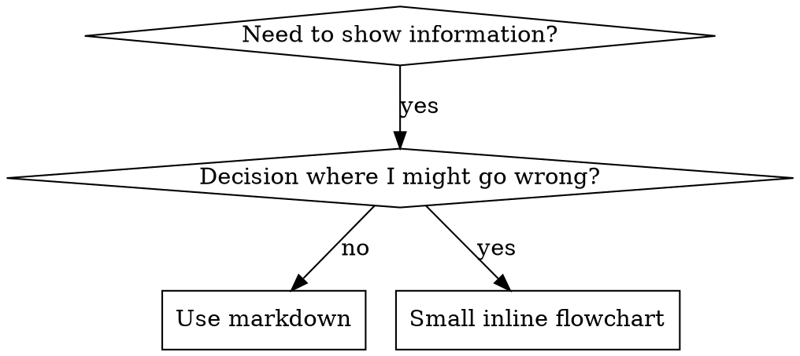

# Writing Skills

Write reusable guidance for a specific class of requests. Check existing skills
before adding another workflow, and keep project-specific rules in repository
guidance. Preserve user decisions and use the environment's actual tools and
permissions.

## When to Create a Skill

**Create when:**
- Technique wasn't intuitively obvious to you
- You'd reference this again across projects
- Pattern applies broadly (not project-specific)
- Others would benefit

**Don't create for:**
- One-off solutions
- Standard practices well-documented elsewhere
- Project-specific conventions (use the repository's existing AGENTS.md or CLAUDE.md)
- Mechanical constraints (if it's enforceable with regex/validation, automate it--save documentation for judgment calls)

## Skill Types

### Technique
Concrete method with steps to follow (condition-based-waiting, root-cause-tracing)

### Pattern
Way of thinking about problems (flatten-with-flags, test-invariants)

### Reference
API docs, syntax guides, tool documentation (office docs)

## SKILL.md Structure

**Frontmatter (YAML):**
- Shared skills use `name` and `description`; keep native settings in harness templates
- `name`: Use lowercase letters, numbers, and hyphens only
- `description`: Third-person; describes what the skill does and when to use it
  - State the capability and the requests or conditions that should trigger it
  - Include specific symptoms, situations, and contexts
  - Keep workflow details in the body (see Skill Discovery below)
  - Keep under 500 characters if possible

```markdown
---
name: skill-name-with-hyphens
description: "[Capability]. Use when [specific requests or triggering conditions]."
---

# Skill Name

## Overview
What is this? Core principle in 1-2 sentences.

## When to Use
[Small inline flowchart IF decision non-obvious]

Bullet list with SYMPTOMS and use cases
When NOT to use

## Core Pattern (for techniques/patterns)
Before/after code comparison

## Quick Reference
Table or bullets for scanning common operations

## Implementation
Inline code for simple patterns
Link to file for heavy reference or reusable tools

## Common Mistakes
What goes wrong + fixes

## Real-World Impact (optional)
Concrete results
```


## Skill Discovery

**Critical for discovery:** An agent needs to find the skill for the right request.

### 1. Rich Description Field

**Purpose:** The description helps decide which skill applies. Make it answer: "Should I read this skill right now?"

**Format:** State the capability and the specific requests or conditions that should trigger it.

**Include both what the skill does and when it applies.**

Keep the summary specific and concise. Describe the outcome and trigger context;
leave the detailed procedure in the body.

```yaml
# ❌ BAD: Too vague to distinguish from other development skills
description: Helps with development

# ❌ BAD: Too much process detail
description: Use for TDD - write test first, watch it fail, write minimal code, refactor

# ✅ GOOD: Capability and trigger context
description: Executes written implementation plans. Use when carrying out an agreed plan with independent tasks in the current session.

# ✅ GOOD: Outcome and concrete symptoms
description: Diagnoses software failures from evidence. Use when investigating bugs, failing tests, or unexpected behavior.
```

**Content:**
- Use concrete triggers, symptoms, and situations that signal this skill applies
- Describe the *problem* (race conditions, inconsistent behavior) not *language-specific symptoms* (setTimeout, sleep)
- Keep triggers technology-agnostic unless the skill itself is technology-specific
- If skill is technology-specific, make that explicit in the trigger
- Write in third person
- Summarize the capability and trigger context; keep procedural steps in the body

```yaml
# ❌ BAD: Too abstract, vague, doesn't include when to use
description: For async testing

# ❌ BAD: First person
description: I can help you with async tests when they're flaky

# ❌ BAD: Mentions technology but skill isn't specific to it
description: Use when tests use setTimeout/sleep and are flaky

# ✅ GOOD: Capability and concrete symptoms
description: Investigates asynchronous test failures. Use when tests have race conditions, timing dependencies, or inconsistent results.

# ✅ GOOD: Technology-specific capability and trigger
description: Reviews React Router authentication redirects. Use when diagnosing route guards or redirect loops in React Router applications.
```

### 2. Keyword Coverage

Use words Claude would search for:
- Error messages: "Hook timed out", "ENOTEMPTY", "race condition"
- Symptoms: "flaky", "hanging", "zombie", "pollution"
- Synonyms: "timeout/hang/freeze", "cleanup/teardown/afterEach"
- Tools: Actual commands, library names, file types

### 3. Descriptive Naming

**Use active voice, verb-first:**
- ✅ `creating-skills` not `skill-creation`
- ✅ `condition-based-waiting` not `async-test-helpers`

## Keep References and Examples Focused

Use concise instructions without deleting useful domain guidance. Put large
references and supporting scripts in the skill folder and load them when needed.
Keep one strong example for each distinct concept; avoid repeating the same
checklist in several sections.

Reference existing skills by their actual names, such as
`verification-before-completion`, and resources by paths relative to the skill.
Check that every referenced resource exists. Do not assume upstream skills,
agent tools, or native permission settings are available in another harness.

## Flowchart Usage



**Use flowcharts ONLY for:**
- Non-obvious decision points
- Process loops where you might stop too early
- "When to use A vs B" decisions

**Never use flowcharts for:**
- Reference material -> Tables, lists
- Code examples -> Markdown blocks
- Linear instructions -> Numbered lists
- Labels without semantic meaning (step1, helper2)

Follow graphviz style conventions: descriptive labels, consistent shapes (diamonds for decisions, boxes for actions).

## Code Examples

**One excellent example beats many mediocre ones**

Choose most relevant language:
- Testing techniques -> TypeScript/JavaScript
- System debugging -> Shell/Python
- Data processing -> Python

**Good example:**
- Complete and runnable
- Well-commented explaining WHY
- From real scenario
- Shows pattern clearly
- Ready to adapt (not generic template)

**Don't:**
- Implement in 5+ languages
- Create fill-in-the-blank templates
- Write contrived examples

You're good at porting - one great example is enough.

## File Organization

### Self-Contained Skill
```
defense-in-depth/
  SKILL.md    # Everything inline
```
When: All content fits, no heavy reference needed

### Skill with Reusable Tool
```
condition-based-waiting/
  SKILL.md    # Overview + patterns
  example.ts  # Working helpers to adapt
```
When: Tool is reusable code, not just narrative

### Skill with Heavy Reference
```
pptx/
  SKILL.md       # Overview + workflows
  pptxgenjs.md   # 600 lines API reference
  ooxml.md       # 500 lines XML structure
  scripts/       # Executable tools
```
When: Reference material too large for inline

## Testing All Skill Types

Different skill types need different test approaches:

### Discipline-Enforcing Skills (rules/requirements)

**Examples:** verification-before-completion, git-push

**Test with:**
- Academic questions: Do they understand the rules?
- Pressure scenarios: Do they comply under stress?
- Multiple pressures combined: time + sunk cost + exhaustion
- Identify rationalizations and add explicit counters

**Success criteria:** Agent follows rule under maximum pressure

### Technique Skills (how-to guides)

**Examples:** condition-based-waiting, root-cause-tracing, defensive-programming

**Test with:**
- Application scenarios: Can they apply the technique correctly?
- Variation scenarios: Do they handle edge cases?
- Missing information tests: Do instructions have gaps?

**Success criteria:** Agent successfully applies technique to new scenario

### Pattern Skills (mental models)

**Examples:** reducing-complexity, information-hiding concepts

**Test with:**
- Recognition scenarios: Do they recognize when pattern applies?
- Application scenarios: Can they use the mental model?
- Counter-examples: Do they know when NOT to apply?

**Success criteria:** Agent correctly identifies when/how to apply pattern

### Reference Skills (documentation/APIs)

**Examples:** API documentation, command references, library guides

**Test with:**
- Retrieval scenarios: Can they find the right information?
- Application scenarios: Can they use what they found correctly?
- Gap testing: Are common use cases covered?

**Success criteria:** Agent finds and correctly applies reference information

## Compare Behavior When Instructions Change

For a meaningful behavior change, use realistic scenarios and compare results:

1. Run a representative case against the existing instructions or without the new
   rule. Record what the agent actually does and where it misses the requirement.
2. Make the smallest instruction change addressing that gap. Run the same case
   again and inspect the behavior, rather than accepting a claim of compliance.
3. Exercise a variation or ambiguous case. For discipline rules, consider relevant
   pressure such as urgency or conflicting requests; for reference skills, check
   retrieval accuracy and applicability to the targeted version.
4. Revise only demonstrated gaps and recheck the affected cases. Use supported
   agent tools and honor the user's requested agent count and scope.

Scale verification to the change. Mechanical moves and wording edits can use
build, link, and content checks. Static checks validate packaging and references;
they do not establish equivalent live agent behavior. Report that distinction
with `verification-before-completion`.

Use `update-readme` when discovery or invocation changes. Installation, publishing,
and external contributions require authorization beyond authoring unless the user
already requested them.
